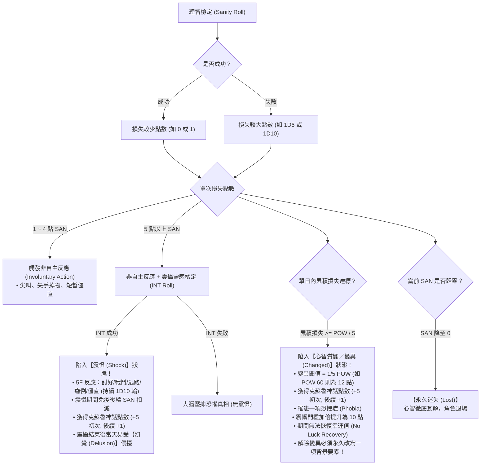
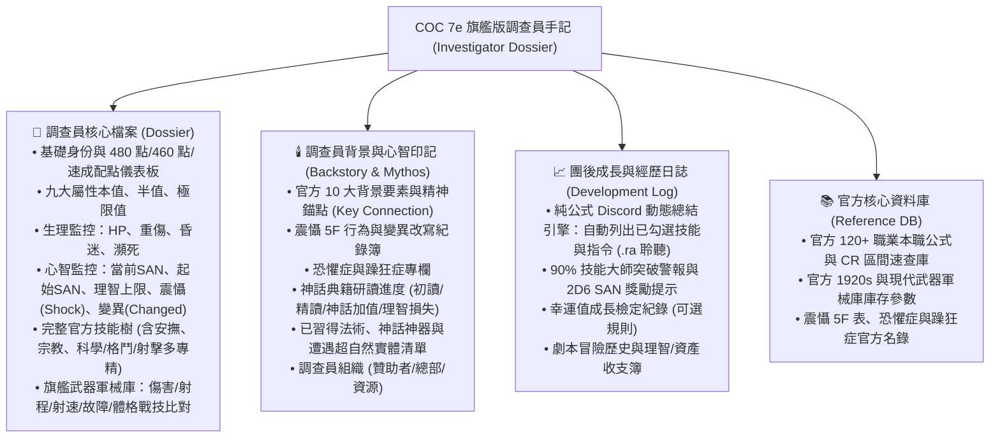

# 《克蘇魯的呼喚》第七版（COC 7e）旗艦角色卡完整規則規格書
## 核心規則書與守秘人手冊新規則全面彙整（Official Rules & Keeper's Companion Specification）

> **權威來源**：
> 1. 《Call of Cthulhu: Keeper Rulebook (7th Edition)》（第七版核心規則書，Core Rulebook）
> 2. 《Call of Cthulhu: Keeper's Companion》（守秘人伴侶／規則修訂版，最新官方擴充）
> 3. 本機路徑：`C:\Repos\COC7e Investigator\COC Rulebook\`
>
> **本規格書用途**：在正式生成新版 Google 試算表角色卡前，將所有**即將呈現在角色卡中、用於底層計算、狀態監控與表單驗證的完整官方規則**，逐一進行條文化、公式化與架構化記錄。

---

## 目錄
1. [九大基礎屬性與創角生成規則（含 Companion 480 點分配法）](#1-九大基礎屬性與創角生成規則)
2. [官方完整年齡修正全表與流程](#2-官方完整年齡修正全表與流程)
3. [衍生屬性、生理監控與戰鬥指標](#3-衍生屬性生理監控與戰鬥指標)
4. [理智系統革命：心智崩潰、震懾（Shock）與變異（Changed）新規則](#4-理智系統革命心智崩潰震懾shock與變異changed新規則)
5. [本職點數、個人興趣點與信用評級經濟學](#5-本職點數個人興趣點與信用評級經濟學)
6. [修訂版技能譜系、專門細項與最低門檻規則（Companion 更新）](#6-修訂版技能譜系專門細項與最低門檻規則)
7. [戰鬥戰技、槍械特技與交戰機制（Core + Companion）](#7-戰鬥戰技槍械特技與交戰機制)
8. [背景故事十要素、精神錨點與調查員組織](#8-背景故事十要素精神錨點與調查員組織)
9. [團後成長階段全流程（Development Phase）](#9-團後成長階段全流程development-phase)
10. [新版角色卡四大分頁呈現規格與欄位規劃](#10-新版角色卡四大分頁呈現規格與欄位規劃)

---

## 1. 九大基礎屬性與創角生成規則

角色卡將呈現九項基本特徵值，每一項均自動顯示「**本值（Regular）**」、「**半值／困難（Hard, $\lfloor \text{值}/2 \rfloor$）**」與「**五分之一值／極限（Extreme, $\lfloor \text{值}/5 \rfloor$）**」。

### 1.1 屬性功能與計算
| 屬性代號 | 英文名稱 | 中文名稱 | 規則用途與在角色卡中的關聯 |
| :---: | :---: | :---: | :--- |
| **STR** | Strength | 力量 | 決定傷害加值（DB）、體格（Build）、近戰傷害、攀爬與跳躍。 |
| **CON** | Constitution | 體質 | 決定最大生命值（HP）、重傷檢定、抗毒與環境耐受。 |
| **SIZ** | Size | 體型 | 決定最大生命值（HP）、傷害加值（DB）與體格（Build）。 |
| **DEX** | Dexterity | 敏捷 | 決定戰鬥先攻（DEX順序）、基礎閃避值（$\lfloor \text{DEX}/2 \rfloor$）、近身射擊距離。 |
| **APP** | Appearance | 外貌 | 決定社交第一印象、魅惑／說服檢定、**安撫（Reassure）技能基礎值（$\lfloor \text{APP}/5 \rfloor$）**。 |
| **INT** | Intelligence | 智力／靈感 | 決定**個人興趣點數（$\text{INT} \times 2$）**、震懾靈感檢定（Shock INT Roll）、現場推理。 |
| **POW** | Power | 意志 | 決定起始理智值（$\text{SAN} = \text{POW}$）、最大魔法值（$\lfloor \text{POW}/5 \rfloor$）、**變異閾值（$\lfloor \text{POW}/5 \rfloor$）**。 |
| **EDU** | Education | 教育 | 決定**本職技能點數基礎**、**母語初始值（$\text{EDU}\%$）**、知識（Know）檢定。 |
| **LUCK** | Luck | 幸運 | 燃燒幸運補足檢定差距、決定環境隨機事件。**不設半值與極限值**。 |

### 1.2 官方四種生成模式（於角色卡中提供選擇）
1. **標準隨機法（Standard 3D6/2D6+6）**：
   - $\text{STR, CON, DEX, APP, POW, LUCK} = 3\text{D}6 \times 5$（15–90 點）
   - $\text{SIZ, INT, EDU} = (2\text{D}6 + 6) \times 5$（40–90 點）
2. **Keeper's Companion 480 點分配法（最新官方修訂，Companion p.10）**：
   - 總共提供 **480 點** 自由分配於 STR、CON、SIZ、DEX、APP、INT、POW、EDU 八大屬性。
   - 單項屬性上限 90 點，建議下限 30 點。
   - 幸運（LUCK）另外公開擲 $3\text{D}6 \times 5$。
3. **Core Rulebook 460 點購點法（Core p.48 Option 4）**：
   - 總共提供 **460 點** 自由分配於八大屬性（範圍 15–90 點），LUCK 獨立擲骰。
4. **速成配置法（Quick Fire，Core p.48 Option 5）**：
   - 固定提供八組數值：`80, 70, 60, 60, 60, 50, 50, 40`，玩家自由分配至八大屬性，LUCK 獨立擲骰。

---

## 2. 官方完整年齡修正全表與流程

依據 Core Rulebook p.32–34，年齡修正必須在屬性確定後**立即套用**，直接影響後續衍生屬性與技能點。角色卡將根據「輸入年齡」自動呈現檢查清單與扣點／增益狀態：

| 年齡區間 | 力量／體質／敏捷懲罰 | 體型／外貌調整 | 教育（EDU）成長檢定 | 幸運與移動力調整 |
| :---: | :--- | :--- | :---: | :--- |
| **15–19 歲** | STR 或 SIZ 扣 5 點 | EDU 扣 5 點 | 無增長檢定 | LUCK 擲兩次 $3\text{D}6 \times 5$ 取高者。MOV 不減。 |
| **20–39 歲** | 無懲罰 | 無調整 | 進行 **1 次** EDU 增長檢定 | MOV 不減。 |
| **40–49 歲** | STR/CON/DEX 任選扣 **5 點** | APP 扣 5 點 | 進行 **2 次** EDU 增長檢定 | **MOV 減 1**。 |
| **50–59 歲** | STR/CON/DEX 任選扣 **10 點** | APP 扣 10 點 | 進行 **3 次** EDU 增長檢定 | **MOV 減 2**。 |
| **60–69 歲** | STR/CON/DEX 任選扣 **20 點** | APP 扣 15 點 | 進行 **4 次** EDU 增長檢定 | **MOV 減 3**。 |
| **70–79 歲** | STR/CON/DEX 任選扣 **40 點** | APP 扣 20 點 | 進行 **4 次** EDU 增長檢定 | **MOV 減 4**。 |
| **80–89 歲** | STR/CON/DEX 任選扣 **80 點** | APP 扣 25 點 | 進行 **4 次** EDU 增長檢定 | **MOV 減 5**。 |

> **EDU 成長檢定公式**：在 Discord 擲 $1\text{D}100 > \text{當前 EDU}$（或 96–100），成功則在 Discord 擲 $1\text{D}10$ 加入 EDU，最高上限 99。

---

## 3. 衍生屬性、生理監控與戰鬥指標

### 3.1 生命值與傷病狀態（Core p.33 + Companion p.74 傷害流程圖）
- **最大生命值（Max HP）**：$$\text{Max HP} = \left\lfloor \frac{\text{CON} + \text{SIZ}}{10} \right\rfloor$$
- **重傷閾值（Major Wound Threshold）**：$$\text{重傷線} = \left\lfloor \frac{\text{Max HP}}{2} \right\rfloor$$
- **生理狀態欄位**：
  - `正常（Healthy）`：未受重傷，HP > 0。
  - `重傷（Major Wound）`：單次受到 $\ge$ 重傷線傷害，打勾標記，須作 CON 檢定防昏迷。
  - `昏迷（Unconscious）`：HP 降至 0 但無重傷，1 小時後甦醒回復 1 HP。
  - `瀕死（Dying）`：**HP 降至 0 且帶有重傷**。每輪結束須進行 CON 檢定，未獲急救/醫學成功則宣告死亡。

### 3.2 傷害加值（DB）與體格（Build）官方對照表（Core p.33 Table 1）
依據 $\text{STR} + \text{SIZ}$ 總和自動判定：
- $2 \sim 64$：$\text{DB} = -2$, $\text{Build} = -2$
- $65 \sim 84$：$\text{DB} = -1$, $\text{Build} = -1$
- $85 \sim 124$：$\text{DB} = 0$, $\text{Build} = 0$
- $125 \sim 164$：$\text{DB} = +1\text{D}4$, $\text{Build} = +1$
- $165 \sim 204$：$\text{DB} = +1\text{D}6$, $\text{Build} = +2$
- $205 \sim 284$：$\text{DB} = +2\text{D}6$, $\text{Build} = +3$
- $285 \sim 364$：$\text{DB} = +3\text{D}6$, $\text{Build} = +4$
- 往後每 $+80$ 點，DB 增加 $+1\text{D}6$，Build 增加 $+1$。

### 3.3 移動力（MOV）與 Companion 戰鬥移動點數（MvP）
1. **基礎 MOV 三段比對**：
   - 若 $\text{STR} < \text{SIZ}$ 且 $\text{DEX} < \text{SIZ}$ $\rightarrow \text{MOV} = 7$。
   - 若 $\text{STR} \ge \text{SIZ}$ 或 $\text{DEX} \ge \text{SIZ}$（或三者相等） $\rightarrow \text{MOV} = 8$。
   - 若 $\text{STR} > \text{SIZ}$ 且 $\text{DEX} > \text{SIZ}$ $\rightarrow \text{MOV} = 9$。
2. **扣除年齡懲罰**（40歲起每增10歲減1，最低為 1）。
3. **Companion 戰鬥移動點數（MvP, Companion p.77）**：$$\text{MvP} = \text{MOV}$$可在戰鬥中用於走位、尋找掩體或穿越險境。

---

## 4. 理智系統革命：心智崩潰、震懾（Shock）與變異（Changed）新規則

角色卡將完整落實《Keeper's Companion》第 3 章（p.85–96）最新官方理智修訂系統，徹底超越傳統模糊的發瘋設定：

### 4.1 理智四大核心數值
1. **起始理智（Starting SAN）**：等於創角時的意志（POW）。
2. **理智極限（Max SAN）**：$$99 - \text{克蘇魯神話技能 (Cthulhu Mythos)}$$
3. **震懾臨界點（Shock Threshold）**：單次損耗 **5 點**（若處於 Changed 狀態則提升為 **10 點**）。
4. **質變／變異臨界點（Changed Threshold）**：固定等於 **$\lfloor \text{POW} / 5 \rfloor$**（例如 POW 65 則單日累積損失達 13 點即質變）。

### 4.2 震懾的 5F 行為反應表（Table 4: Shock Effects）
當進入震懾時，調查員在 $1\text{D}10$ 輪內（或場外 $1\text{D}10$ 小時）表現出以下本能反應之一：
- **Fawn（討好迎合）**：向恐怖存在或威脅者屈膝哀求、附和。
- **Fight（狂暴戰鬥）**：不顧一切攻擊最近的生物。
- **Flight（驚慌逃竄）**：拋棄所有物品奪路狂奔。
- **Flop（癱軟崩潰）**：四肢無力癱倒在地，無法移動。
- **Freeze（僵立不動）**：完全石化僵直，失去外界認知。

### 4.3 官方五大理智恢復途徑（Companion p.94–96）
角色卡將設置理智恢復追蹤欄：
1. **同伴安撫（Reassurance）**：隊友使用「安撫」或社交技能檢定，成功立即恢復 **+2 點 SAN**（每個劇本每名調查員限一次；大失敗扣 1D6）。
2. **守秘人劇本通關獎勵（Keeper Award）**：依擊破神話威脅程度給予獎勵骰（如 1D6、1D10）。
3. **90% 技能大師里程碑（90% Skill Milestone）**：任一技能首次提升至 90% 以上，調查員心靈獲得極大昇華，**立即獲得 +2D6 點 SAN**！
4. **精神分析治療（Psychotherapy）**：專業心理醫生檢定，成功恢復 **+1D3 點 SAN**（大失敗扣 1D6）。
5. **精神錨點自我修復（Self-Help）**：團間與關鍵聯結（Key Connection）互動並進行 INT/POW 困難檢定，成功恢復 **+1D6 點 SAN**（失敗則扣 1 點 SAN 並必須重寫背景）。

---

## 5. 本職點數、個人興趣點與信用評級經濟學

### 5.1 本職技能點計算公式群
角色卡將根據下拉選單選擇的「職業」，自動套用公式並計算總點數：
- **EDU $\times 4$**：學者、醫師、圖書館員、古董家、律師、科學家。
- **$\text{EDU}\times 2 + (\text{STR}\text{ 或 }\text{DEX})\times 2$**：警探、私家偵探、特工、水手、探險家。
- **$\text{EDU}\times 2 + \text{DEX}\times 2$**：運動員、飛賊、雜技演員。
- **$\text{EDU}\times 2 + \text{STR}\times 2$**：鐵匠、伐木工、礦工。
- **$\text{EDU}\times 2 + \text{APP}\times 2$**：演員、藝術家、名媛、詐欺師。
- **$\text{EDU}\times 2 + \text{POW}\times 2$**：神職人員、心理學家、靈媒。

### 5.2 個人興趣點
$$\text{興趣點} = \text{INT} \times 2$$

### 5.3 信用評級（CR）生活水平與資產官方折算表（Core p.46–47）
角色卡支援 **1920 年代** 與 **現代** 切換，自動依據當前 CR 計算財力：

#### 1920s 經濟標準
| CR 區間 | 階層名稱 | 隨身現金（Cash） | 消費水準（免記帳支出） | 資產總額（Assets） |
| :---: | :---: | :---: | :---: | :---: |
| **0** | 身無分文（Penniless） | \$0.50 | \$0.50 | \$0 |
| **1–9** | 貧民階層（Poor） | $\text{CR} \times \$1$ | \$2 | $\text{CR} \times \$10$ |
| **10–49** | 中產普通（Average） | $\text{CR} \times \$2$ | \$10 | $\text{CR} \times \$50$ |
| **50–89** | 富裕優渥（Wealthy） | $\text{CR} \times \$5$ | \$50 | $\text{CR} \times \$500$ |
| **90–98** | 頂層富豪（Rich） | $\text{CR} \times \$20$ | \$250 | $\text{CR} \times \$2,000$ |
| **99** | 超級巨富（Super Rich） | \$50,000 | \$5,000 | \$5,000,000+ |

---

## 6. 修訂版技能譜系、專門細項與最低門檻規則

依據 Core Rulebook 第 4 章及《Keeper's Companion》第 1 章（p.16–24）最新官方技能整合：

### 6.1 整合與新增技能清單（Companion Updates）
1. **人類學（Anthropology）**：正式歸類為 **科學（人類學）**，初始值 1%。
2. **估價（Appraise）**：正式歸類為 **藝術與手工（估價）**，初始值 5%。
3. **偽造／喬裝（Disguise）**：正式歸類為 **藝術與手工（喬裝）**，初始值 5%。
4. **【新增技能】安撫（Reassure）**：
   - 官方初始值：**$\lfloor \text{APP} / 5 \rfloor$**（五分之一外貌值！）。
   - 用於安撫受驚嚇隊友、平息震懾、回復 +2 點理智值。
5. **【新增技能】宗教（Religion）**：初始值 **10%**（獨立於神秘學之外，代表正統神學與世界宗教知識）。
6. **電鋸（Chainsaw）與連枷（Flail）**：初始值提升至 **15%**。

### 6.2 格鬥與射擊最低門檻規則（Companion Option: Specialization Minimums, p.20）
Keeper's Companion 提出了極具邏輯性的互通門檻規則，角色卡將設有自動檢驗或提醒公式：
- **格鬥專精下限**：調查員的任何格鬥專精（鬥毆、斧、劍、連枷、矛等），**不得低於其最高格鬥技能數值的一半（$\lfloor \text{最高格鬥}/2 \rfloor$）**！
  - *實例*：若鬥毆為 60%，其拿起不熟悉的劍或斧頭時，該技能最低即擁有 30%（而非 15% 或 20%）。
- **射擊專精下限**：調查員的任何射擊專精（手槍、步槍/霰彈、衝鋒槍等），**不得低於其最高射擊技能數值的一半（$\lfloor \text{最高射擊}/2 \rfloor$）**！
  - *實例*：若手槍為 70%，其使用步槍時最低享有 35% 技能值。

### 6.3 完整技能清單與基礎百分比
- **交際類**：魅惑 (15%)、話術 (5%)、恐嚇 (15%)、說服 (10%)、心理學 (10%)、安撫 ($\lfloor \text{APP}/5 \rfloor$)。
- **運動與敏捷類**：攀爬 (20%)、閃避 ($\lfloor \text{DEX}/2 \rfloor$)、跳躍 (20%)、隱密 (20%)、游泳 (20%)、投擲 (20%)、騎術 (5%)。
- **學術與科學類**：會計 (5%)、歷史 (5%)、法律 (5%)、圖書館使用 (20%)、醫學 (1%)、神秘學 (5%)、宗教 (10%)、科學專門項（化學 1%、生物 1%、物理 1%、天文 1%、地質 1%、藥學 1%、法醫 1%、密碼 1%、工程 1%、氣象 1%、人類學 1%、數學 10%）。
- **技術與操作類**：電器維修 (10%)、機械維修 (10%)、重機械操作 (1%)、鎖匠 (1%)、妙手 (10%)、汽車駕駛 (20%)、駕駛各類 (1%)。
- **感知與生存類**：急救 (30%)、偵查 (25%)、聆聽 (20%)、追蹤 (10%)、導航 (10%)、生存各類 (10%)。
- **戰鬥專精類**：
  - 格鬥：鬥毆 (25%)、斧頭 (15%)、劍術 (20%)、連枷 (15%)、矛 (20%)、絞繩 (15%)、鞭子 (15%)、電鋸 (15%)。
  - 射擊：手槍 (20%)、步槍/霰彈 (25%)、衝鋒槍 (15%)、機槍 (15%)、重武器 (15%)、弓弩 (15%)、火焰噴射器 (15%)。
- **特殊受限**：
  - **克蘇魯神話（Cthulhu Mythos）**：初始 0%，**創角時完全嚴禁分配點數**。
  - **母語**：等於 $\text{EDU}\%$；外語：每門 1%。

---

## 7. 戰鬥戰技、槍械特技與交戰機制

### 7.1 戰術戰技與體格比對（Core p.105–106）
當進行擒抱、繳械、推倒或摔跤時，由雙方「體格（Build）」決定難度：
- 防禦者 Build $\le$ 攻擊者 Build $\rightarrow$ 正常檢定（無懲罰）。
- 防禦者 Build 比攻擊者高 1 點 $\rightarrow$ 攻擊者承受 **1 顆懲罰骰（-1P）**。
- 防禦者 Build 比攻擊者高 2 點 $\rightarrow$ 攻擊者承受 **2 顆懲罰骰（-2P）**。
- 防禦者 Build 比攻擊者高 3 點以上 $\rightarrow$ **戰技完全無效（無法對巨怪使用戰技！）**。

### 7.2 Companion 槍械特技（Firearm Maneuvers, Companion p.68–69）
角色卡武器欄位將收錄以下戰技提示：
1. **製造恐慌（Cause Panic）**：在公共場合鳴槍或持槍威嚇，迫使人群或對手進行理智檢定或潰散。
2. **持槍挾持／槍口命令（Hold at Gunpoint）**：以已準備好的槍械指著目標保留行動，其敏捷先攻極高。若目標試圖動作，持槍者立即搶先開火！
3. **近身射擊（Point-Blank Range）**：目標距離在 $\lfloor \text{DEX}/5 \rfloor$ 呎之內，射擊獲得 **1 顆獎勵骰（+1B）**。

---

## 8. 背景故事十要素、精神錨點與調查員組織

依據 Core Rulebook p.157 與《Keeper's Companion》p.25–42：

### 8.1 官方背景十要素與關鍵聯結（Key Connection）
1. **個人外貌特徵（Personal Description）**
2. **意識形態與信念（Ideology / Beliefs）**
3. **重要之人（Significant People）** —— 誰最重要？為何重要？
4. **意義非凡之地（Meaningful Locations）**
5. **珍視之物（Treasured Possessions）**
6. **個人特質（Traits）**
7. **傷痕與疤痕（Injuries & Scars）**
8. **恐懼症與躁狂症（Phobias & Manias）**
9. **神秘典籍、法術與神話神器（Arcane Tomes, Spells & Artifacts）**
10. **遭遇超自然實體紀錄（Encounters with Strange Entities）**

> **關鍵聯結（Key Connection）**：玩家指定其中一項為「精神錨點」。若此聯結被毀壞，調查員直接喪失 1D6 點理智；團間互動則可修復 1D6 點理智。

### 8.2 解除「變異（Changed）」的代價（Companion p.92–93）
- 調查員若在冒險中陷入 Changed 狀態，在團後休整時**必須永久改寫或替換十要素中的其中一項**，具體呈現神話恐怖對其靈魂留下的不可磨滅的烙印！

### 8.3 調查員組織（Investigator Organizations, Companion p.29）
收錄組織設定欄：贊助者（Patron）、總部地點（Headquarters）、可調用公費資源（Funding & Resources）。

---

## 9. 團後成長階段全流程（Development Phase）

### 9.1 技能成長結算
1. 劇本中凡是常規成功且未使用獎勵骰的技能，打勾 $\boxtimes$。
2. 團後在 Discord 公開擲 $1\text{D}100$：
   - 若 $1\text{D}100 > \text{當前技能值}$ 或 擲出 $96\text{–}100$ $\rightarrow$ 成長成功！
   - 公開擲 $1\text{D}10$，將點數加至「成長」欄位。
3. **90% 技能大師里程碑**：技能首次突破 90%，立即在 Discord 擲 $2\text{D}6$ 回復理智！

### 9.2 幸運值團後恢復（Luck Recovery, Core p.99 官方可選規則）
- 在 Discord 擲 $1\text{D}100 > \text{當前幸運}$，成功則擲 $1\text{D}10$ 恢復幸運值（若調查員處於 Changed 狀態則無法恢復幸運）。

---

## 10. 新版角色卡四大分頁呈現規格與欄位規劃

依據上述全套官方規則，全新旗艦角色卡將分為以下四個獨立專責分頁：

---
*本規格書為 COC 7e 旗艦角色卡生成工程的最高執行準則。*
