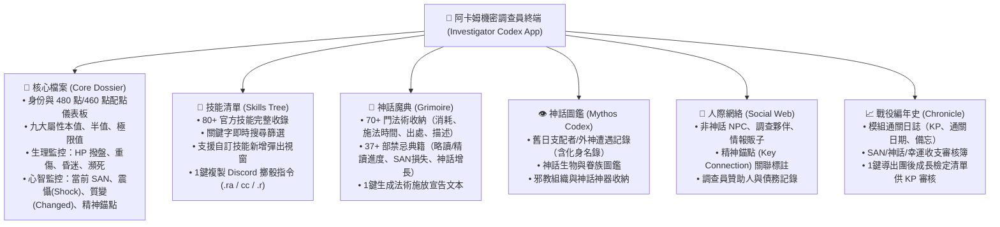

# 《克蘇魯的呼喚》第七版（COC 7e）調查員終端完整規則規格書
## 核心規則書與守秘人伴侶修訂版全面彙整（Official Rules & Keeper's Companion Specification）

> **權威來源**：
> 1. 《Call of Cthulhu: Keeper Rulebook (7th Edition)》（第七版核心規則書，Core Rulebook）
> 2. 《Call of Cthulhu: Keeper's Companion (Revised Edition)》（守密人伴侶／規則修訂版，最新官方擴充）
> 3. 本機路徑：`references/COC Rulebook/`
>
> **本規格書用途**：作為「阿卡姆機密調查員終端（Investigator Codex App）」底層計算、狀態機推演、技能譜系與表單驗證的完整官方規則手冊，逐一進行條文化、公式化與架構化記錄。

---

## 目錄
1. [九大基礎屬性與創角生成規則（含 Companion 480 點分配法）](#1-九大基礎屬性與創角生成規則)
2. [官方完整年齡修正全表與流程](#2-官方完整年齡修正全表與流程)
3. [衍生屬性、生理監控與戰鬥指標](#3-衍生屬性生理監控與戰鬥指標)
4. [理智系統革命：心智崩潰、震懾（Shock）與質變（Changed）新規則](#4-理智系統革命心智崩潰震懾shock與質變changed新規則)
5. [本職點數、個人興趣點與信用評級經濟學](#5-本職點數個人興趣點與信用評級經濟學)
6. [修訂版技能譜系、專門細項與最低門檻規則（Companion 更新）](#6-修訂版技能譜系專門細項與最低門檻規則)
7. [戰鬥戰技、槍械特技與交戰機制（Core + Companion）](#7-戰鬥戰技槍械特技與交戰機制)
8. [背景故事十要素、精神錨點與調查員組織](#8-背景故事十要素精神錨點與調查員組織)
9. [團後成長階段全流程（Development Phase）](#9-團後成長階段全流程development-phase)
10. [調查員終端 APP 核心功能架構與模組規劃](#10-調查員終端-app-核心功能架構與模組規劃)

---

## 1. 九大基礎屬性與創角生成規則

終端呈現九項基本特徵值，每一項均即時計算並自動顯示「**本值（Regular）**」、「**半值／困難（Hard, $\lfloor \text{值}/2 \rfloor$）**」與「**五分之一值／極限（Extreme, $\lfloor \text{值}/5 \rfloor$）**」。

### 1.1 屬性功能與計算
| 屬性代號 | 英文名稱 | 中文名稱 | 規則用途與在終端中的關聯 |
| :---: | :---: | :---: | :--- |
| **STR** | Strength | 力量 | 決定傷害加值（DB）、體格（Build）、近戰傷害、攀爬與跳躍。 |
| **CON** | Constitution | 體質 | 決定最大生命值（HP）、重傷檢定、抗毒與環境耐受。 |
| **SIZ** | Size | 體型 | 決定最大生命值（HP）、傷害加值（DB）與體格（Build）。 |
| **DEX** | Dexterity | 敏捷 | 決定戰鬥先攻（DEX順序）、基礎閃避值（$\lfloor \text{DEX}/2 \rfloor$）、近身射擊距離。 |
| **APP** | Appearance | 外貌 | 決定社交第一印象、魅惑／說服檢定、**安撫（Reassure）技能基礎值（$\lfloor \text{APP}/5 \rfloor$）**。 |
| **INT** | Intelligence | 智力／靈感 | 決定**個人興趣點數（$\text{INT} \times 2$）**、震懾靈感檢定（Shock INT Roll）、現場推理。 |
| **POW** | Power | 意志 | 決定起始理智值（$\text{SAN} = \text{POW}$）、最大魔法值（$\lfloor \text{POW}/5 \rfloor$）、**質變閾值（$\lfloor \text{POW}/5 \rfloor$）**。 |
| **EDU** | Education | 教育 | 決定**本職技能點數基礎**、**母語初始值（$\text{EDU}\%$）**、知識（Know）檢定。 |
| **LUCK** | Luck | 幸運 | 燃燒幸運補足檢定差距、決定環境隨機事件。**不設半值與極限值**。 |

### 1.2 官方四種生成模式
1. **標準隨機法（Standard 3D6/2D6+6）**：
   - $\text{STR, CON, DEX, APP, POW, LUCK} = 3\text{D}6 \times 5$（15–90 點）
   - $\text{SIZ, INT, EDU} = (2\text{D}6 + 6) \times 5$（40–90 點）
2. **Keeper's Companion 480 點分配法（最新官方修訂，Companion p.10）**：
   - 總共提供 **480 點** 自由分配於 STR、CON、SIZ、DEX、APP、INT、POW、EDU 八大屬性。
   - 單項屬性上限 90 點，建議下限 30 點。
   - 幸運（LUCK）另外公開擲 $3\text{D}6 \times 5$。
3. **Core Rulebook 460 點購點法（Core p.48 Option 4）**：
   - 總共提供 **460 點** 自由分配於八大屬性（範圍 15–90 點），LUCK 獨立擲骰。
4. **速成配置法（Quick Fire，Core p.48 Option 5）**：
   - 固定提供八組數值：`80, 70, 60, 60, 60, 50, 50, 40`，玩家自由分配至八大屬性，LUCK 獨立擲骰。

---

## 2. 官方完整年齡修正全表與流程

依據 Core Rulebook p.32，年齡將自動影響移動力（MOV）與教育增長：

| 年齡區間 | 屬性減值（自由分配） | 教育增長檢定（EDU Check） | 移動力修正（MOV Penalty） | 外貌修正（APP Penalty） |
| :---: | :---: | :---: | :---: | :---: |
| **15–19 歲** | STR 或 SIZ 減 5 點；EDU 減 5 點 | 幸運可擲兩次取較高者 | MOV 不變 | APP 不變 |
| **20–39 歲** | 無減值 | 進行 **1 次** EDU 增長檢定 | MOV 不變 | APP 不變 |
| **40–49 歲** | STR、CON 或 DEX 合計減 5 點 | 進行 **2 次** EDU 增長檢定 | **MOV -1** | APP 減 5 點 |
| **50–59 歲** | STR、CON 或 DEX 合計減 10 點 | 進行 **3 次** EDU 增長檢定 | **MOV -2** | APP 減 10 點 |
| **60–69 歲** | STR、CON 或 DEX 合計減 20 點 | 進行 **4 次** EDU 增長檢定 | **MOV -3** | APP 減 15 點 |
| **70–79 歲** | STR、CON 或 DEX 合計減 40 點 | 進行 **4 次** EDU 增長檢定 | **MOV -4** | APP 減 20 點 |
| **80–89 歲** | STR、CON 或 DEX 合計減 80 點 | 進行 **4 次** EDU 增長檢定 | **MOV -5** | APP 減 25 點 |

> **MOV 計算公式**：
> - 若 $\text{STR} < \text{SIZ}$ 且 $\text{DEX} < \text{SIZ}$ $\rightarrow$ 基礎 $\text{MOV} = 7$
> - 若 $\text{STR} > \text{SIZ}$ 且 $\text{DEX} > \text{SIZ}$ $\rightarrow$ 基礎 $\text{MOV} = 9$
> - 其他情況 $\rightarrow$ 基礎 $\text{MOV} = 8$
> - 最終 $\text{MOV} = \max(1, \text{基礎 MOV} - \text{年齡修正})$

---

## 3. 衍生屬性、生理監控與戰鬥指標

### 3.1 生命值與生理狀態機（Hit Points & Vitals）
- **最大生命值**：$\text{Max HP} = \lfloor (\text{CON} + \text{SIZ}) / 10 \rfloor$
- **重傷閾值（Major Wound Threshold）**：$\text{Threshold} = \lfloor \text{Max HP} / 2 \rfloor$（單次受傷 $\ge$ 此值標記重傷）
- **生理狀態即時推演**：
  - $\text{HP} \le -\text{Max HP}$ $\rightarrow$ **💀 瞬間致死（Instant Death）**
  - $\text{HP} \le 0$ 且 **重傷標記** $\rightarrow$ **⚠️ 瀕死（Dying，每輪需做 CON 檢定）**
  - $\text{HP} \le 0$ 且 **無重傷** $\rightarrow$ **💤 昏迷（Unconscious，1 小時後自動甦醒）**
  - $\text{HP} > 0$ 且 **重傷標記** $\rightarrow$ **🩹 重傷受創（需每週醫療休養恢復）**
  - $0 < \text{HP} < \text{Max HP}$ $\rightarrow$ **🤕 輕傷微恙（每日自然恢復 1 點）**
  - $\text{HP} = \text{Max HP}$ $\rightarrow$ **💚 健康健全（Healthy）**

### 3.2 魔法值（Magic Points）
- $\text{Max MP} = \lfloor \text{POW} / 5 \rfloor$
- 自然恢復速度：每小時自然恢復 1 點 MP。
- MP 耗盡時可燃燒 HP 施法（1 HP = 1 MP）。

### 3.3 傷害加值（DB）與體格（Build）
- 計算總和：$\text{Sum} = \text{STR} + \text{SIZ}$
- $\text{Sum} \le 64 \rightarrow \text{DB} = -2, \text{Build} = -2$
- $65 \le \text{Sum} \le 84 \rightarrow \text{DB} = -1, \text{Build} = -1$
- $85 \le \text{Sum} \le 124 \rightarrow \text{DB} = 0, \text{Build} = 0$
- $125 \le \text{Sum} \le 164 \rightarrow \text{DB} = +1\text{D}4, \text{Build} = 1$
- $165 \le \text{Sum} \le 204 \rightarrow \text{DB} = +1\text{D}6, \text{Build} = 2$
- $205 \le \text{Sum} \le 284 \rightarrow \text{DB} = +2\text{D}6, \text{Build} = 3$

---

## 4. 理智系統革命：心智崩潰、震懾（Shock）與質變（Changed）新規則

依據《Keeper's Companion》大修之理智規則：

### 4.1 震懾（Shock · 5F 急性反應）
- **觸發條件**：單次損失理智 $\ge 5$ 點，且通過智力檢定（INT Roll 成功，代表調查員完全理解了眼前的不可名狀恐怖）。
- **急性症狀**：陷入維持 $1\text{D}10$ 輪的 **5F 應激反應**：
  1. **Fight (戰鬥)**：狂暴攻擊眼前威脅，無視自身安全。
  2. **Flight (逃跑)**：不顧一切向後狂奔，逃離現場。
  3. **Freeze (僵直)**：肌肉石化呆立，無法採取自主動作。
  4. **Fawn (討好)**：對恐怖存在產生屈從、祈憐或阿諛行為。
  5. **Flop (癱軟)**：精神昏厥癱倒在地，意識模糊。

### 4.2 心智質變（Changed · 世界觀崩塌）
- **觸發條件**：單日內累計理智損失 $\ge \lfloor \text{POW} / 5 \rfloor$ 點。
- **質變影響**：
  1. **幸運值凍結**：質變期間無法透過任何休整恢復幸運值。
  2. **靈魂烙印**：團後休整時必須永久改寫背景故事十要素之一。
  3. **精神錨點**：與精神錨點互動可檢定回復 $1\text{D}6$ SAN。

---

## 5. 本職點數、個人興趣點與信用評級經濟學

- **本職點數（Occupation Points）**：依據職業公式（如私家偵探為 $\text{EDU}\times 2 + (\text{STR or DEX})\times 2$）。
- **個人興趣點數（Interest Points）**：固定為 $\text{INT} \times 2$。
- **信用評級（Credit Rating）**：限制調查員消費水準、現金與資產總額。

---

## 6. 修訂版技能譜系、專門細項與最低門檻規則

收錄完整官方 80+ 技能，並包含伴侶修訂版新增技能：
- **安撫（Reassure）**：基礎值 $\lfloor \text{APP} / 5 \rfloor$，成功可為隊友抵消 1 點理智損失或撫平震懾餘波。
- **格鬥專精（Fighting Specialties）**：鬥毆（Brawl）、斧（Axe）、劍（Sword）、矛（Spear）、電鋸（Chainsaw）等。
- **射擊專精（Firearms Specialties）**：手槍（Handgun）、步槍/霰彈（Rifle/Shotgun）、衝鋒槍（SMG）、機槍（Machine Gun）、弓弩（Bow）。

---

## 7. 戰鬥戰技、槍械特技與交戰機制

- **體格戰技（Fighting Maneuvers）**：
  - 我方體格 $\ge$ 目標體格：常規檢定。
  - 目標體格大於我方 1 點：承受 1 顆懲罰骰（-1P）。
  - 目標體格大於我方 2 點：承受 2 顆懲罰骰（-2P）。
  - 目標體格大於我方 3 點以上：無法進行抓抱、擒拿等物理戰技。
- **近身射擊（Point-Blank）**：距離 $\le \lfloor \text{DEX} / 5 \rfloor$ 呎內射擊，獲得 +1 獎勵骰。

---

## 8. 背景故事十要素、精神錨點與調查員組織

1. 個人外貌特徵（Personal Description）
2. 意識形態與信念（Ideology / Beliefs）
3. 重要之人（Significant People）
4. 意義非凡之地（Meaningful Locations）
5. 珍視之物（Treasured Possessions）
6. 個人特質（Traits）
7. 傷痕與疤痕（Injuries & Scars）
8. 恐懼症與躁狂症（Phobias & Manias）
9. 神秘典籍、法術與神話神器（Arcane Tomes, Spells & Artifacts）
10. 遭遇超自然實體紀錄（Encounters with Strange Entities）

---

## 9. 團後成長階段全流程（Development Phase）

1. 劇本中凡常規成功發揮之技能勾選標記（☑）。
2. 團後在 Discord 公開擲 $1\text{D}100$：若 $> \text{當前值}$ 或 $\ge 96$，成功擲 $1\text{D}10$ 增長點數。
3. 技能突破 90% 時獲得大師獎勵：回復 $2\text{D}6$ 理智！

---

## 10. 調查員終端 APP 核心功能架構與模組規劃

阿卡姆機密調查員終端（Investigator Codex App）依據上述全套官方規則，分為六大獨立專責功能模組：

---
*本規格書為阿卡姆機密調查員終端 (Investigator Codex App) 的核心規則執行標準。*
